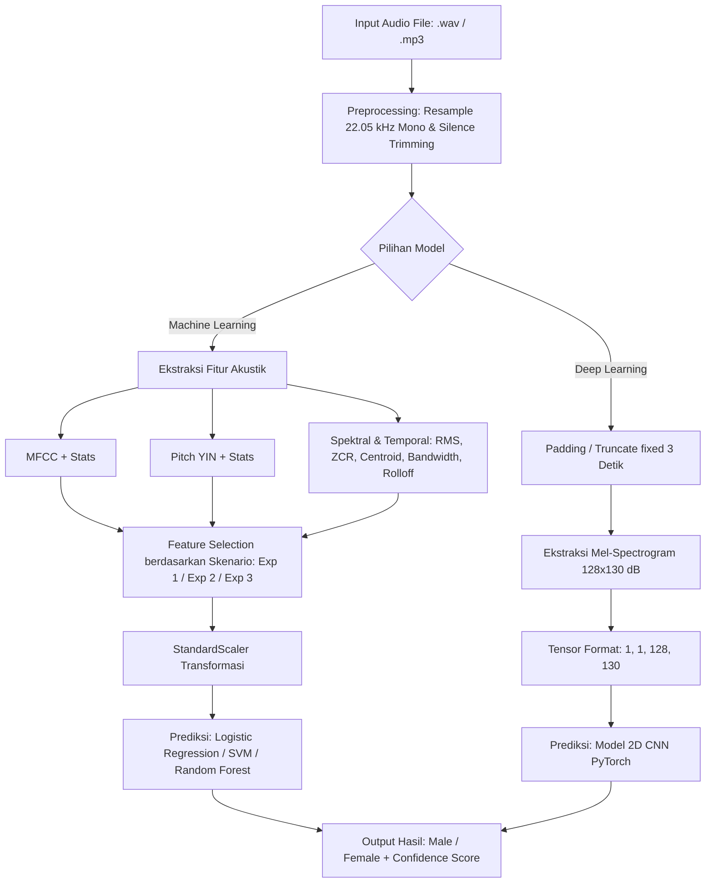

# 🎙️ Voice Recognition & Gender Classification

Aplikasi dan pipeline Machine Learning & Deep Learning untuk **klasifikasi jenis kelamin berbasis suara (Voice Gender Recognition)** dengan antarmuka web interaktif berbasis Flask.

Proyek ini membandingkan pendekatan **Machine Learning Konvensional** (Logistic Regression, Support Vector Machine, dan Random Forest) dengan berbagai skenario fitur audio akustik (MFCC, Pitch, Gabungan/Hybrid) serta pendekatan **Deep Learning** menggunakan **Convolutional Neural Network (CNN)** berbasis Mel-Spectrogram 2D.

---

## 📌 Daftar Isi
- [Ringkasan Proyek](#-ringkasan-proyek)
- [Fitur Utama](#-fitur-utama)
- [Arsitektur & Pendekatan Model](#-arsitektur--pendekatan-model)
  - [1. Skenario Fitur (Machine Learning)](#1-skenario-fitur-machine-learning)
  - [2. Deep Learning (CNN Spectrogram)](#2-deep-learning-cnn-spectrogram)
- [Struktur Proyek](#-struktur-proyek)
- [Prasyarat & Dependensi](#-prasyarat--dependensi)
- [Panduan Instalasi](#-panduan-instalasi)
- [Cara Penggunaan](#-cara-penggunaan)
  - [1. Menjalankan Web UI](#1-menjalankan-web-ui)
  - [2. Ekstraksi Fitur & Pembuatan Dataset](#2-ekstraksi-fitur--pembuatan-dataset)
  - [3. Pelatihan Model (Training)](#3-pelatihan-model-training)
  - [4. Eksplorasi via Jupyter Notebook](#4-eksplorasi-via-jupyter-notebook)
- [Alur Kerja Sistem (Pipeline)](#-alur-kerja-sistem-pipeline)
- [Metrik Evaluasi](#-metrik-evaluasi)
- [Lisensi](#-lisensi)

---

## Ringkasan Proyek

Sistem ini dirancang untuk mengidentifikasi apakah suatu sampel suara berasal dari suara **Pria (Male)** atau **Wanita (Female)**. Klasifikasi dilakukan dengan menganalisis karakteristik fisik gelombang audio, seperti frekuensi fundamental (*pitch*), timbre vokal (*MFCC*), distribusi energi spektral (*centroid, bandwidth, rolloff*), dinamika energi (*RMS*), dan kestabilan frekuensi (*Zero Crossing Rate*).

Selain eksperimen *benchmark* algoritma, proyek ini dilengkapi antarmuka web (Web UI) yang memungkinkan pengguna mengunggah rekaman suara (`.wav`, `.mp3`) atau merekam langsung melalui mikrofon untuk mendapatkan hasil prediksi beserta skor probabilitas (confidence score) secara instan.

---

## Fitur Utama

- **Multi-Model Support**:
  - **Logistic Regression**: Baseline model linier cepat dan efisien.
  - **Support Vector Machine (SVM - RBF Kernel)**: Unggul dalam menangani pemisahan non-linier pada dimensi tinggi.
  - **Random Forest Classifier**: Ensemble model berbasis pohon keputusan yang kokoh terhadap overfitting.
  - **Convolutional Neural Network (PyTorch)**: Arsitektur 2D CNN yang membaca representasi visual Mel-Spectrogram dari suara.
- **Beragam Skenario Fitur Akustik**:
  - Eksperimen 1: Fitur MFCC (13 koefisien) + Fitur Spektral & Temporal.
  - Eksperimen 2: Fitur Fundamental Pitch (F0) + Fitur Spektral & Temporal.
  - Eksperimen 3 (Hybrid): Gabungan MFCC, Pitch, Spektral, dan Temporal.
- **Audio Preprocessing Otomatis**:
  - Resampling konsisten (22.050 Hz Mono).
  - Voice Activity Detection (VAD) sederhana berupa pemotongan keheningan (*silence trimming*) menggunakan `librosa.effects.trim`.
  - Normalisasi durasi / padding / segmentasi untuk input model.
- **Web UI Interaktif**:
  - Dashboard interaktif modern berbasis Flask.
  - Pilihan bebas untuk menentukan model (RF, SVM, LR, CNN) dan skenario fitur.
  - Visualisasi hasil prediksi, persentase kepercayaan, dan metadata pemrosesan.

---

## Arsitektur & Pendekatan Model

### 1. Skenario Fitur (Machine Learning)
Fitur diekstraksi menggunakan pustaka `librosa` dengan metrik statistik (*mean, std, min, max*):
- **MFCC (Mel-Frequency Cepstral Coefficients)**: 13 koefisien yang merepresentasikan bentuk saluran vokal manusia.
- **Pitch / Fundamental Frequency ($F_0$)**: Estimasi frekuensi dasar menggunakan algoritma YIN (`fmin=50 Hz`, `fmax=500 Hz`). Pria umumnya memiliki rentang pitch lebih rendah (~85–180 Hz) dibandingkan wanita (~165–255 Hz).
- **Fitur Domain Spektral**:
  - *Spectral Centroid*: Pusat massa spektrum frekuensi suara (tingkat ketajaman suara).
  - *Spectral Bandwidth*: Lebar pita spektral.
  - *Spectral Rolloff*: Frekuensi batas di mana akumulasi energi mencapai persentase tertentu.
- **Fitur Domain Waktu (Temporal)**:
  - *Root Mean Square (RMS)*: Energi gelombang audio.
  - *Zero Crossing Rate (ZCR)*: Laju sinyal berpindah tanda positif/negatif.
  - *Mean Amplitude*: Rata-rata amplitudo absolut sinyal.

| Skenario | Fitur yang Digunakan |
| :--- | :--- |
| **Exp 1: MFCC** | MFCC (1-13) + Centroid + Bandwidth + Rolloff + RMS + ZCR |
| **Exp 2: Pitch** | Pitch (YIN) + Centroid + Bandwidth + Rolloff + RMS + ZCR |
| **Exp 3: Hybrid**| MFCC + Pitch + Centroid + Bandwidth + Rolloff + RMS + ZCR |

### 2. Deep Learning (CNN Spectrogram)
- **Representasi**: Mel-Spectrogram 2D berdimensi `128 x 130` (tinggi frekuensi Mel x bingkai waktu).
- **Arsitektur Model PyTorch**:
  - `Conv2D (1 -> 32, kernel 3x3)` + `ReLU` + `MaxPool2d(2)`
  - `Conv2D (32 -> 64, kernel 3x3)` + `ReLU` + `MaxPool2d(2)`
  - `AdaptiveAvgPool2d((4, 4))`
  - `Flatten` -> `Dense (1024 -> 64)` + `ReLU` + `Dropout(0.5)`
  - `Dense (64 -> 1)` + `Sigmoid` (Output biner: `0 = Male`, `1 = Female`)

---

## Struktur Proyek

```text
voice-recognition-logistic-regression/
│
├── dataset/                      # Direktori data audio mentah
│   ├── build_dataset.py          # Skrip ekstraksi fitur & pembuatan dataset CSV/NPY
│   ├── female/                   # Sampel audio wanita (.wav / .mp3)
│   └── male/                     # Sampel audio pria (.wav / .mp3)
│
├── prepocessing/                 # Modul pemrosesan awal sinyal audio
│   ├── voice_preprocessing_ml.py # Preprocessing untuk Machine Learning (trimming, normalisasi)
│   └── voice_preprocessing_dl.py # Preprocessing untuk CNN (fixed length padding 3 detik)
│
├── features/                     # Modul ekstraksi fitur akustik
│   ├── feature_extractor_ml.py   # Ekstraksi statistik MFCC, Pitch, Spektral, Temporal
│   └── feature_extractor_dl.py   # Ekstraksi Mel-Spectrogram dalam format matriks dB
│
├── models/                       # Definisi arsitektur model
│   ├── ML/
│   │   └── ml_models.py          # Definisi Logistic Regression, SVM, Random Forest
│   ├── DL/
│   │   └── CNN_model.py          # Arsitektur PyTorch CNN 2D
│   └── export_utils.py           # Utilitas penyimpanan bobot model dan scaler
│
├── exported_models/              # File model & scaler siap pakai
│   ├── cnn_spectrogram_weights.pth
│   ├── lr_exp1_mfcc.joblib, lr_exp2_pitch.joblib, lr_exp3_hybrid.joblib
│   ├── rf_exp1_mfcc.joblib, rf_exp2_pitch.joblib, rf_exp3_hybrid.joblib
│   ├── svm_exp1_mfcc.joblib, svm_exp2_pitch.joblib, svm_exp3_hybrid.joblib
│   └── scaler_exp*.joblib
│
├── scripts/                      # Skrip pelatihan mandiri
│   ├── tradisional/              # Skrip training ML (Exp 1, Exp 2, Exp 3)
│   │   ├── train_exp1_mfcc.py
│   │   ├── train_exp2_pitch.py
│   │   └── train_exp3_hybrid.py
│   └── modern/                   # Skrip training CNN
│       └── cnn_spectrogram.py
│
├── web-ui/                       # Antarmuka web pengguna
│   ├── app.py                    # Server Flask backend & API inference
│   ├── static/                   # Aset CSS, JS, dan styling
│   └── templates/                # File HTML UI (index.html)
│
├── dataset_fitur_audio.csv       # Dataset hasil ekstraksi fitur tabular (ML)
├── voice-recognition.ipynb       # Notebook eksperimen komprehensif & analisis data
├── requirements.txt              # Daftar pustaka dependensi Python
└── README.md                     # Dokumentasi proyek
```

---

## Prasyarat & Dependensi

Pastikan perangkat Anda telah terpasang:
- **Python**: Versi `3.9` hingga `3.11` (disarankan)
- **FFmpeg**: Dibutuhkan oleh pustaka audio seperti `librosa` dan `soundfile` untuk membaca format `.mp3`.

Pustaka utama yang digunakan:
- `flask`, `flask-cors` (Web Framework & API)
- `librosa`, `soundfile` (Pengolahan Audio & Sinyal)
- `scikit-learn` (Machine Learning: LR, SVM, Random Forest, Scaler, Metrics)
- `torch`, `torchvision` (Deep Learning: CNN PyTorch)
- `numpy`, `pandas` (Manipulasi Data Array & Tabular)
- `joblib` (Serialisasi Model & Scaler)
- `matplotlib`, `seaborn` (Visualisasi & Plotting)
- `tqdm` (Progress bar ekstraksi dataset)

---

## Panduan Instalasi

1. **Clone repositori atau unduh folder proyek:**
   ```bash
   git clone <URL_REPOSITORY_ANDA>
   cd voice-recognition-logistic-regression-main
   ```

2. **Buat virtual environment (Direkomendasikan):**
   ```bash
   # Windows (PowerShell / Command Prompt)
   python -m venv venv
   .\venv\Scripts\activate

   # Linux / macOS
   python3 -m venv venv
   source venv/bin/activate
   ```

3. **Install dependensi:**
   ```bash
   pip install -r requirements.txt
   ```
   *(Jika Anda mengunduh dari sumber awal dengan `requirements.txt` minimal, jalankan perintah lengkap berikut:)*
   ```bash
   pip install flask flask-cors librosa soundfile scikit-learn torch torchvision numpy pandas joblib tqdm matplotlib seaborn
   ```

---

## Cara Penggunaan

### 1. Menjalankan Web UI
Untuk memulai antarmuka web interaktif:

```bash
cd web-ui
python app.py
```
Setelah server berjalan, buka peramban (*browser*) Anda dan akses:
```
http://127.0.0.1:5000
```
**Langkah inferensi di web:**
1. Pilih model prediksi (`Random Forest`, `SVM`, `Logistic Regression`, atau `CNN`).
2. Tentukan skenario fitur yang diinginkan (`MFCC`, `Pitch`, atau `Hybrid`).
3. Unggah file rekaman suara (`.wav` atau `.mp3`).
4. Klik tombol **Prediksi** untuk melihat hasil klasifikasi beserta nilai persentase keyakinan.

---

### 2. Ekstraksi Fitur & Pembuatan Dataset
Jika Anda menambahkan file audio baru di folder `dataset/male/` atau `dataset/female/`, Anda dapat mengekstrak ulang seluruh fiturnya:

```bash
python dataset/build_dataset.py
```
Perintah ini akan membaca seluruh data audio secara *multithreaded* dan menghasilkan:
- `dataset_fitur_audio.csv`: Berisi puluhan fitur statistik numerik untuk model Machine Learning.
- `x_spectrogram_data.npy` & `y_gender_labels.npy`: Matriks spektrogram untuk model Deep Learning.

---

### 3. Pelatihan Model (Training)

#### Model Machine Learning (Tradisional)
Jalankan salah satu skrip eksperimen di folder `scripts/tradisional/`:

```bash
# Eksperimen 1: Berbasis MFCC
python -c "from scripts.tradisional.train_exp1_mfcc import run_experiment_1; run_experiment_1()"

# Eksperimen 2: Berbasis Pitch
python -c "from scripts.tradisional.train_exp2_pitch import run_experiment_2; run_experiment_2()"

# Eksperimen 3: Fitur Hybrid
python -c "from scripts.tradisional.train_exp3_hybrid import run_experiment_3; run_experiment_3()"
```

#### Model Deep Learning (CNN Spectrogram)
```bash
python scripts/modern/cnn_spectrogram.py
```

---

### 4. Eksplorasi via Jupyter Notebook
Untuk melakukan exploratory data analysis (EDA), visualisasi distribusi gelombang audio, matriks korelasi, hingga evaluasi confusion matrix secara visual:

```bash
jupyter notebook voice-recognition.ipynb
```

---

## Alur Kerja Sistem (Pipeline)



---

## Metrik Evaluasi

Setiap eksperimen dievaluasi menggunakan metrik standar klasifikasi biner:
- **Accuracy**: Tingkat kebenaran prediksi keseluruhan.
- **Precision**: Ketepatan prediksi positif.
- **Recall (Sensitivity)**: Proporsi sampel positif yang berhasil terdeteksi.
- **F1-Score**: Rata-rata harmonik antara precision dan recall.
- **Confusion Matrix**: Matriks visualisasi True Positive, True Negative, False Positive, dan False Negative.

---
